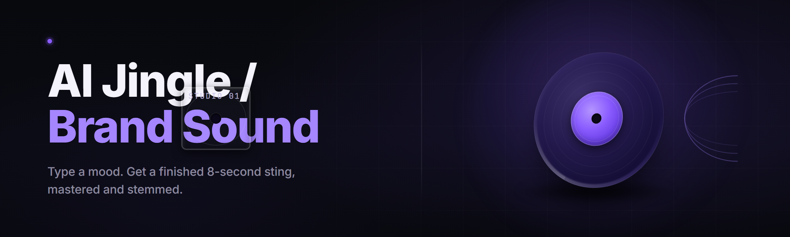

  
  
  

  

  
  

---

**The generative audio workstation that turns a text prompt into a broadcast-ready brand jingle in under 90 seconds.**

---

## 📦 What You Need First

Before you touch the installer, confirm your machine clears the bar. The Forge is a real audio engine, not a web toy — it renders stems locally on your CPU/GPU and writes finished masters to disk.

| Requirement | Minimum | Why It Matters |
|---|---|---|
| OS | Windows 10 21H2 (x64) | WASAPI loopback + DirectML runtime |
| CPU | 4-core / 8-thread, SSE4.2 | Real-time stem mixing thread pool |
| RAM | 8 GB | 16 GB for batch jingle farms |
| GPU | Any DX12 card, 2 GB VRAM | Neural vocoder acceleration (falls back to CPU) |
| Disk | 3.2 GB free | Model weights + preset banks + render cache |
| Audio | Any WASAPI device | Preview monitoring; export needs none |
| Runtime | VC++ 2019–2022 x64 redistributable | Bundled in the installer |

> The Forge ships as a self-contained `.exe`. No pip, no npm, no build tools, no developer account. Download, extract, double-click.

---

## 🧠 What is AI Jingle & Brand Sound Forge?

The Forge is a text-to-jingle generator built for podcasters, indie game studios, YouTubers, radio producers, Twitch channels, and brand teams who need original, license-clean audio stingers without hiring a composer or licensing a stock track. You describe the vibe. The Forge writes the melody, arranges the instrumentation, sings the hook (or uses a text-to-voice tag), and masters it to broadcast loudness.

| Term | Explanation |
|---|---|
| **Jingle** | A 5–45 second stinger with a melodic hook, usually containing a brand name spoken or sung. |
| **Stinger** | A sub-5-second sonic logo — the "bwoosh," the "ding," the three-note tag. |
| **Sonic Logo** | A repeatable 2–4 note motif that becomes audio-identifiable with your brand. |
| **Stem** | An isolated render layer (drums, bass, melody, vocals, FX) exported separately for editing. |
| **Seed Lock** | A fixed generation seed so a jingle can be reproduced bit-for-bit later. |
| **Brand Vector** | A saved profile holding your tempo range, key, instrument palette, and voice timbre. |
| **Loudness Target** | The LUFS normalization standard applied at export (podcast, YouTube, broadcast). |

**Why producers reach for it:**

- 🎛️ **Prompt-to-master in one pass** — no DAW round-trip for a simple stinger.
- 🧬 **Brand Vector memory** — every jingle you generate can inherit a saved sonic identity.
- 🎚️ **Stems included** — every render drops isolated WAVs alongside the master.
- 🔒 **Seed-locked reproducibility** — regenerate the exact same jingle six months from now.
- 📻 **Broadcast loudness presets** — -14 LUFS (YouTube), -16 (podcast), -23 (EBU R128).
- 🧾 **License-clean output** — you own every render; no royalties, no attribution.

---

## ⚡ Key Features

| Feature | Description | Benefit |
|---|---|---|
| Prompt Composer | Type "lo-fi chill hop, female vocal tag, 12 seconds, warm" and hit render. | Zero music theory required. |
| Sonic Logo Forge | Extract a 3-note motif from any jingle into a reusable brand tag. | Instant audio identity. |
| Text-to-Voice Tags | Type your brand name; the Forge sings or speaks it inside the hook. | No session singer needed. |
| Brand Vector Profiles | Save tempo, key, palette, and timbre as a reusable preset. | Every future jingle sounds like *you*. |
| Stem Export | Renders drums, bass, melody, vocal, FX as separate WAVs. | Full DAW editability. |
| Loudness Mastering | One-click LUFS normalization for podcast / YouTube / broadcast. | No post-processing pass. |
| Seed Lock | Freeze the RNG seed for bit-identical regeneration. | A/B test with confidence. |
| Batch Jingle Farm | Queue 50 prompts overnight and wake up to 50 finished masters. | Volume production for ad networks. |
| MIDI Drag-Out | Export the generated melody as a `.mid` file for your DAW. | Remix and re-orchestrate freely. |
| Reference Match | Feed a 10-second reference clip; the Forge matches its tempo, key, and energy. | Match a client's existing campaign. |
| Duckable Beds | Generate an under-voice bed that auto-ducks under a voiceover. | Podcast intros that behave. |
| Format Presets | Instagram, TikTok, YouTube, Twitch, radio spot, game menu loop. | One click to the right length. |

---

## 🛠️ How to Get the Forge

### Download the installer

  

---

## 🚀 Get Started in Four Steps

1. **📍 Visit the project page** — read the release notes, then grab the bundled installer archive from the download section on the landing page.
2. **📦 Extract the archive** — right-click → Extract All → pick a folder with write access (avoid `C:\Program Files` unless you plan to run the Forge elevated for plugin scanning).
3. **🖱️ Run the `.exe`** — double-click the executable. Windows SmartScreen may show an "unknown publisher" prompt on first launch; click **More info → Run anyway**. This is normal for independently distributed audio tools.
4. **🎛️ Complete the first-run wizard** — the Forge downloads its 2.1 GB model weight pack on first launch, verifies checksums, then asks you to name your first Brand Vector. That's it. You can render your first jingle before the wizard finishes its coffee.

---

## 🗂️ Table of Contents

- [What You Need First](#-what-you-need-first)
- [What is AI Jingle & Brand Sound Forge?](#-what-is-ai-jingle--brand-sound-forge)
- [Key Features](#-key-features)
- [Get Started in Four Steps](#-get-started-in-four-steps)
- [The Problem](#-the-problem)
- [The Solution](#-the-solution)
- [Quick Start — Your First Jingle](#-quick-start--your-first-jingle)
- [Module Catalog](#-module-catalog)
- [Comparison](#-comparison)
- [Hotkeys](#-hotkeys)
- [System Requirements](#-system-requirements)
- [Installation Deep-Dive](#-installation-deep-dive)
- [Usage Guidelines](#-usage-guidelines)
- [Known Issues](#-known-issues)
- [FAQ](#-faq)
- [Tips for Best Results](#-tips-for-best-results)

---

## 🧩 The Problem

Anyone shipping audio content for a brand hits the same wall, over and over:

- **Stock libraries sound like stock libraries.** The free-tier track you licensed has been used on 40,000 other podcasts — listeners recognize it and mentally file your show as "generic."
- **Custom composition is expensive and slow.** A real jingle composer charges $400–$3,000 and takes two weeks, with revision rounds that eat your launch window.
- **Editing a loop into a stinger is fiddly.** Trimming a 3-minute track to 11 seconds while keeping the hook lands you either an awkward cut or missing the drop entirely.
- **Licensing is a legal minefield.** "Royalty-free" doesn't always mean "indemnifiable." A DMCA claim on your podcast intro is a bad Tuesday.
- **Vocal tags are impossible for solo creators.** You want your brand name *sung* in the hook, but you don't sing and a session vocalist is another invoice.
- **Every new episode needs a fresh variation.** The same 11-second jingle on 200 episodes starts to feel like a broken alarm clock.
- **Matching an existing campaign's energy is guesswork.** You describe "upbeat but not cheesy" to a composer and hope they read your mind.

---

## 🎯 The Solution

| Problem | How the Forge Solves It |
|---|---|
| Stock libraries sound generic | Every render is procedurally generated from your prompt — no two creators get the same hook. |
| Custom composition costs $400–$3,000 | Generate unlimited variations locally for free after a one-time download. |
| Trimming loops is fiddly | Length presets (5s / 11s / 15s / 30s / 45s) render to exact duration with intro and outro fades baked in. |
| Licensing minefield | You fully own every render — the Forge ships with a permissive output license, and nothing is sampled from copyrighted material. |
| Can't get a vocal tag | Text-to-voice tags sing or speak your brand name inside the hook, with ten voice timbres to choose from. |
| Same jingle every episode | Batch Jingle Farm + high seed variance gives you an endless supply of variations on the same Brand Vector. |
| Matching campaign energy is guesswork | Reference Match analyzes a 10-second clip and locks tempo, key, and energy before generation. |

---

## 🎬 Quick Start — Your First Jingle

1. **🎤 Open the Prompt Composer** — you'll see four fields: Genre, Mood, Duration, and Tagline.
2. **✍️ Fill the fields** — Genre: `uplifting corporate` · Mood: `confident, warm` · Duration: `11 seconds` · Tagline: `Acme Coffee — brewed for the morning`.
3. **🧬 Pick or create a Brand Vector** — click **New Vector → Warm Morning**. This locks key (F major), tempo (112 BPM), and instrument palette (acoustic guitar, soft piano, brushed drums).
4. **🔊 Hit Render** — first render takes ~20 seconds on GPU, ~90 seconds on CPU-only. Subsequent renders cache the vocoder and drop to ~6 seconds.
5. **📤 Export** — choose **Podcast -16 LUFS** from the mastering dropdown, tick **Include Stems**, and pick your output folder. The Forge writes a master WAV, an MP3, and five stems.

That's a finished jingle. Total time from cold start: four minutes.

---

## 🧱 Module Catalog

### 🎼 Generation Engine

- **Prompt Composer** — the front-door text interface with autocomplete for known genre tags.
- **Melody Weaver** — generates the lead melodic line using a constrained Markov + transformer hybrid.
- **Harmony Resolver** — voices chords under the melody in the selected key and mode.
- **Rhythm Architect** — builds the drum pattern from genre templates, then perturbs it per seed.
- **Arrangement Condenser** — decides which instruments play in which bar so the jingle has shape.

### 🎙️ Voice & Tag Stack

- **Text-to-Voice Tag Engine** — converts your brand name into a sung or spoken line.
- **Voice Timbre Bank** — ten preset voices (warm male, bright female, neutral, robotic, choral, etc.).
- **Pitch Aligner** — snaps the vocal tag to the melody's key so it never sounds off.
- **De-esser & Compressor Chain** — automatic vocal cleanup so tags sit in the mix.
- **Backing Vocal Stacker** — optional doubled and harmony vocal layers.

### 🎛️ Mixing & Mastering

- **Stem Mixer** — per-instrument level, pan, and reverb sends inside the Forge.
- **Loudness Master** — LUFS normalization targeting podcast, YouTube, broadcast, or streaming.
- **Bass Mono-Folder** — collapses the sub-bass to mono for club and car playback safety.
- **Transient Sculptor** — adjusts punch on drums without muddying the low end.
- **Limiter & Ceiling Guard** — final brickwall at -1 dBTP.

### 🧬 Brand Identity

- **Brand Vector Editor** — save and recall key, tempo, palette, voice, and energy.
- **Sonic Logo Extractor** — pull a 3-note motif from any jingle to reuse as a tag.
- **Motif Library** — pitch-shift and re-voice a saved motif into a new key.
- **Consistency Guard** — warns when a new jingle drifts too far from its Brand Vector.
- **Version Snapshotter** — every saved jingle stores its full parameters for future regeneration.

### 📤 Export & Interop

- **Multi-Format Exporter** — WAV, MP3, FLAC, OGG, and AAC in one pass.
- **MIDI Drag-Out** — drag the melody, chords, or bass into any DAW as `.mid`.
- **Stem Folder Packer** — writes isolated stems with naming that DAWs auto-import cleanly.
- **Batch Queue** — CSV-driven batch generation of hundreds of jingles overnight.
- **Reference Matcher** — analyzes a reference clip and clones its tempo, key, and energy.

### ⚙️ Workflow & System

- **Preset Library** — 240 built-in genre presets spanning corporate, lo-fi, edm, orchestral, retro, and more.
- **Project File Format** — `.forgejingle` files store prompts, seeds, and vectors for team handoff.
- **Render Cache** — deduplicates vocoder passes so repeat renders are near-instant.
- **Auto-Updater** — checks for new model packs and bug fixes on launch.
- **Crash-Safe Autosave** — every 30 seconds, renders in progress checkpoint to disk.

| Module | Status | Description |
|---|---|---|
| Prompt Composer | ✅ Working | Front-end text input with genre autocomplete |
| Melody Weaver | ✅ Working | Transformer + Markov hybrid melody generator |
| Harmony Resolver | ✅ Working | Chord voicing engine across 24 keys |
| Rhythm Architect | ✅ Working | Per-seed drum pattern generator |
| Arrangement Condenser | ✅ Working | Per-bar instrument scheduling |
| Text-to-Voice Tag Engine | ✅ Working | Sung/spoken brand-name renderer |
| Voice Timbre Bank | ✅ Working | 10 preset voice characters |
| Pitch Aligner | ✅ Working | Key-locks the vocal tag to the melody |
| Vocal Cleanup Chain | ✅ Working | Internal de-ess + compression |
| Backing Vocal Stacker | ✅ Working | Doubles and harmony layers |
| Stem Mixer | ✅ Working | In-app level, pan, send control |
| Loudness Master | ✅ Working | LUFS targets for podcast/YouTube/broadcast |
| Bass Mono-Folder | ✅ Working | Sub-bass mono collapse |
| Transient Sculptor | ✅ Working | Drum punch shaping without mud |
| Limiter & Ceiling Guard | ✅ Working | -1 dBTP brickwall |
| Brand Vector Editor | ✅ Working | Save/recall brand sonic profiles |
| Sonic Logo Extractor | ✅ Working | Motif extraction to 3-note tag |
| Motif Library | ✅ Working | Re-keying and re-voicing saved motifs |
| Consistency Guard | ✅ Working | Drift warnings vs. Brand Vector |
| Version Snapshotter | ✅ Working | Full-parameter history per jingle |
| Multi-Format Exporter | ✅ Working | WAV/MP3/FLAC/OGG/AAC export |
| MIDI Drag-Out | ✅ Working | Melody/chord/bass `.mid` export |
| Stem Folder Packer | ✅ Working | DAW-friendly stem naming |
| Batch Queue | ✅ Working | CSV-driven overnight generation |
| Reference Matcher | ✅ Working | Tempo/key/energy cloning from a clip |
| Preset Library | ✅ Working | 240 built-in genre presets |
| Project File Format | ✅ Working | `.forgejingle` team handoff format |
| Render Cache | ✅ Working | Vocoder-pass deduplication |
| Auto-Updater | ✅ Working | Model pack and bugfix check on launch |

---

## 🆚 Comparison

| Aspect | Hiring a Composer | Stock Library Track | AI Jingle & Brand Sound Forge |
|---|---|---|---|
| Cost per jingle | $400–$3,000 | $20–$80 one-time | Included after download |
| Turnaround | 1–3 weeks | Immediate | 6–90 seconds |
| Originality | High | Low (heard everywhere) | High (procedural, per-seed) |
| Vocal tag | Session singer extra | Not possible | Built-in, ten timbres |
| Stems | Extra cost | Rarely offered | Always included |
| Loudness mastering | Extra cost | Manual in DAW | One-click LUFS targets |
| Revisions | $50–$200 each | None | Regenerate free |
| License cleanliness | Depends on contract | Depends on library | You own the render |

---

## ⌨️ Hotkeys

| Shortcut | Action |
|---|---|
| `Ctrl + N` | New jingle project |
| `Ctrl + R` | Render current prompt |
| `Ctrl + Shift + R` | Re-render with new seed |
| `Ctrl + S` | Save project (`.forgejingle`) |
| `Ctrl + E` | Open export dialog |
| `Ctrl + B` | Add current prompt to Batch Queue |
| `Ctrl + L` | Toggle loudness mastering preview |
| `Space` | Play / pause preview |
| `Esc` | Cancel in-progress render |
| `F1` | Open help & prompt-tag reference |

---

## 🖥️ System Requirements

| Component | Minimum | Recommended |
|---|---|---|
| OS | Windows 10 21H2 x64 | Windows 11 23H2 x64 |
| CPU | 4-core / 8-thread | 8-core / 16-thread (Ryzen 7 / i7 12th gen or newer) |
| RAM | 8 GB | 16 GB (32 GB for heavy batch) |
| GPU | DX12, 2 GB VRAM | DX12, 8 GB VRAM (RTX 3060 or better) |
| Free Disk | 3.2 GB | 12 GB (large stem + preset libraries) |
| Audio Device | WASAPI out | WASAPI + ASIO for low-latency preview |
| Runtime | VC++ 2019–2022 x64 | Bundled by installer |

---

## 📥 Installation Deep-Dive

1. **Extract the archive.** Right-click the downloaded ZIP → **Extract All** → choose a folder where your Windows user has full write permission. The Forge writes caches and model packs there; a locked-down folder will break first launch.
2. **Launch the executable.** Double-click it. First launch triggers the model pack download (~2.1 GB) — this is a one-time step and the Forge verifies each chunk's checksum before unpacking. If your connection drops mid-download, relaunch and it resumes from the last verified chunk.
3. **Pin, shortcut, or move.** Once running, use **File → Create Desktop Shortcut** if you want the Forge one click away. If you move the install folder later, re-run the shortcut-creation step so the launcher resolves the new path.

> The Forge does not require admin rights and does not write to `Program Files` or the registry. Everything lives in the extracted folder plus `%APPDATA%\JingleForge` for user projects.

---

## 📜 Usage Guidelines

| Allowed | Not allowed |
|---|---|
| Generate jingles for your own podcast, channel, or game | Reselling Forge-generated output as your own composition service without disclosure is discouraged by the community |
| Use Forge output in client work you are paid for | Redistributing the Forge `.exe` or its model packs |
| Batch-generate hundreds of ads for an ad network | Feeding copyrighted reference audio into Reference Match for cloning |
| Remix stems in your DAW | Reverse-engineering or extracting the model weights for resale |
| Ship a game with Forge-made menu loops | Claiming Forge output violates any third-party license (it doesn't — but verify your client's policies) |

---

## 🧯 Known Issues

| Issue | Solution |
|---|---|
| First render takes 90+ seconds on CPU-only machines | Enable GPU acceleration in **Settings → Engine → Device**, or accept the one-time cost; the vocoder caches afterward. |
| SmartScreen shows "unknown publisher" on first launch | Click **More info → Run anyway**. The Forge is independently signed; community builds don't carry an EV cert. |
| Vocal tag sounds pitch-drifted on low seeds | Run **Pitch Aligner** in the tag panel or bump the seed — some seeds generate melody lines that fight common voice ranges. |
| Batch Queue stalls on huge CSVs (>500 rows) | Split the CSV into 200-row chunks; the render cache deduplication is per-batch and slows past that point. |
| MIDI export drag-out fails in older DAWs | Save the `.mid` to disk first, then import — some DAWs don't accept drops from non-elevated apps. |
| Auto-Updater hangs behind corporate proxies | Disable auto-update in **Settings → Updates** and pull new model packs manually from the release page. |

---

## ❔ FAQ

<strong>Do I need an internet connection to use the Forge after install?</strong>

Only for the first-launch model pack download and optional auto-updates. After the weights are on disk, the Forge runs fully offline.

<strong>Who owns the jingles I generate?</strong>

You do. The Forge generates everything procedurally from scratch — no samples are lifted from copyrighted works, and there is no royalty chain. You can publish, monetize, and redistribute your renders freely.

<strong>Can I reproduce the exact same jingle six months from now?</strong>

Yes. Every render stores its seed and full parameter vector inside the `.forgejingle` project file. Reopening that file and hitting Render reproduces the same output bit-for-bit on the same engine version.

<strong>What's the difference between a Brand Vector and a preset?</strong>

A preset is a genre-wide starting point (e.g. "uplifting corporate"). A Brand Vector is *your* saved identity — key, tempo, palette, voice timbre — that every new jingle can inherit so your brand stays sonically consistent across hundreds of renders.

<strong>Can the Forge sing my brand name?</strong>

Yes. The Text-to-Voice Tag Engine takes a short string (typically 2–6 words) and renders it either as a sung hook or a spoken tag, ten voice timbres available. Pitch Aligner key-locks it to the melody automatically.

<strong>Does it work on macOS or Linux?</strong>

Windows 10/11 x64 is the supported target. The engine core is portable and a Linux build is on the roadmap, but the current release ships as a Windows `.exe` only.

<strong>Will the Forge run without a discrete GPU?</strong>

Yes. It falls back to a CPU-only inference path. Renders take roughly 4–5× longer the first time, then cache. A dedicated GPU is recommended if you plan to batch.

<strong>Can I use Reference Match to clone a song I don't own?</strong>

Legally, don't. Reference Match is designed for campaign assets you already have rights to — extracting tempo, key, and energy from copyrighted tracks for commercial reuse is a licensing violation the Forge can't shield you from.

<strong>What LUFS targets are available?</strong>

-14 (YouTube), -16 (podcast), -19 (streaming music), -23 (EBU R128 broadcast), and a flat "no normalization" mode if you want to master yourself.

<strong>Does the Forge phone home or collect analytics?</strong>

No usage analytics are sent. The only network calls are the optional model pack download on first launch and the auto-updater check, both of which can be disabled in Settings.

---

## 🎁 Tips for Best Results

- **Be specific in the prompt.** "Uplifting corporate, warm, 11 seconds, female vocal tag" outperforms "make me a jingle" every single time.
- **Lock a Brand Vector early.** Even two or three jingles in, saving the vector means every future render already sounds like you.
- **Render three seeds before picking one.** The melody variance between seeds is high — the first render is rarely the best.
- **Use stems, don't just use the master.** The melody stem alone often becomes a better stinger than the full mix.
- **Match loudness to your destination.** Podcasts at -16 LUFS, YouTube at -14. Mismatched loudness is the #1 reason a jingle sounds "off" next to a voiceover.
- **Drop the MIDI into your DAW for hero jingles.** The `.mid` export gives you the melody as editable notes — pitch it, transcribe it, re-orchestrate it.
- **Save every parameter.** The Version Snapshotter exists for a reason — a client will ask for "that one from six weeks ago."
- **Watch the Consistency Guard.** If you're drifting too far from your Brand Vector, the Guard fires. Heed it during a campaign, ignore it for one-offs.

---

The Forge is built by a small team of producers and ML engineers who got tired of paying for jingles, tired of trimming loops, and tired of explaining "yes you can hear the hook at eleven seconds" to clients. It ships as a Windows `.exe` because that's what podcast studios and indie game devs actually run, and it renders locally because your brand's audio identity shouldn't live on someone else's server. Download it, name your Brand Vector, and render your first stinger before your coffee gets cold.

  

